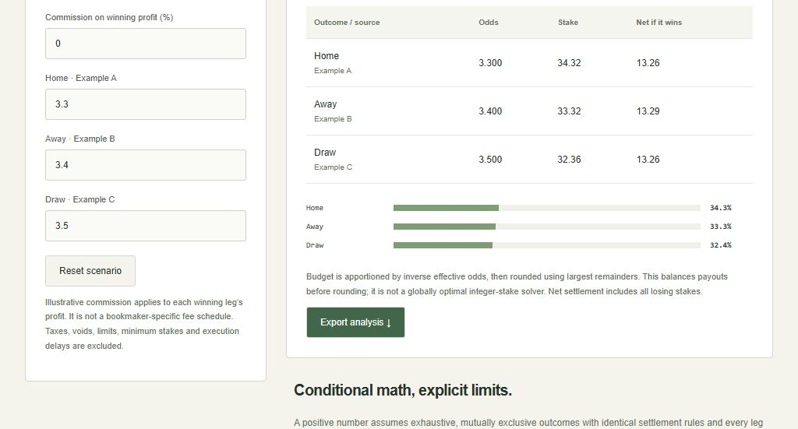

# Arbitrage Finder · Settlement Lab

A read-only odds workbench built on [daankoning/ArbitrageFinder](https://github.com/daankoning/ArbitrageFinder). The original fetcher and GPL-2.0 license are retained. This fork adds named-outcome allocation, cost/rounding analysis, a browser interface and regression tests.



## Try it without an API key

```bash
python -m http.server 49215
```

Open http://localhost:49215. Choose a clearly labeled synthetic two/three-way scenario or a saved historical match, edit decimal odds, budget and illustrative profit commission, inspect every possible settlement, and export the analysis. All computation stays local. The original `arbitrage_opportunities.json` is unchanged: a December 2024 repository snapshot, **not current odds**. Event dates may extend into 2025; individual quote timestamps are absent.

```bash
python main.py --budget 100 --commission 2
python main.py --unformatted --output analysis.json
python -m pip install -r requirements.txt
npm test
```

The default CLI reads the saved snapshot without network access. `--unformatted` now produces valid JSON and exits cleanly. Node 22+ is needed only for Python/JavaScript parity tests; the viewer has no package dependencies.

## Correct settlement math

For effective decimal odds `d[i]`, implied sum `q = sum(1 / d[i])`, and budget `B`, the continuous equal-payout stake is `B / (d[i] * q)`. The theoretical return is `1 / q - 1`. Commission `c` on winning profit gives `d = 1 + (odds - 1) * (1 - c)`.

Whole cents are allocated by largest remainders, preserving the budget. Every outcome reports `stake[i] * d[i] - total spent`. The worst of those settlements is the meaningful lower bound under the stated assumptions. The previous implementation summed mutually exclusive outcome profits and used odds as dictionary keys, which collapsed equal-priced outcomes. Neither behavior remains. Largest-remainder rounding is an apportionment rule, not a globally optimal integer solver; tiny budgets can leave an outcome unfunded and are flagged.

## Explicit live reads

Set `API_KEY` in the environment or a local ignored `.env`, then explicitly opt in:

```bash
python main.py --live-read-only --region us --cutoff 1
```

This consumes [The Odds API](https://the-odds-api.com/liveapi/guides/v4/) quota and never places wagers. API requests have timeouts, request `h2h` markets explicitly, exclude started matches by default, and skip incomplete or invalid bookmaker outcome sets. Soccer requires the draw outcome; a draw reported elsewhere is retained. The cutoff is a theoretical return percentage, not an implied-probability difference. Complete provider outcomes still do not establish identical bookmaker rules; verify void/draw/overtime settlement terms independently before interpreting the math.

## Validation and limits

Seven regression tests cover equal odds, three-way cent allocation, costs removing an edge, invalid/small budgets, Python/browser parity, market selection, missing draws and empty books. The browser checks include commissions turning the synthetic edge negative, historical selection, invalid-input states and responsive layout.

A positive theoretical number is conditional on exhaustive mutually exclusive outcomes, matching settlement rules and all legs accepted at the displayed odds. Bookmaker limits, minimum stakes, taxes, voids and execution delays are excluded. This is an educational analyzer, not a risk-free profit claim or an execution system. Live API behavior was not exercised with credentials in this update.
